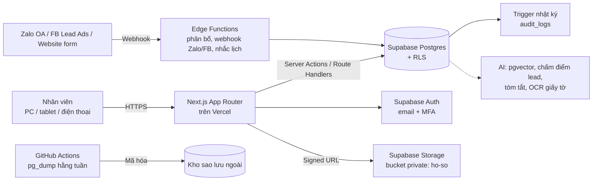
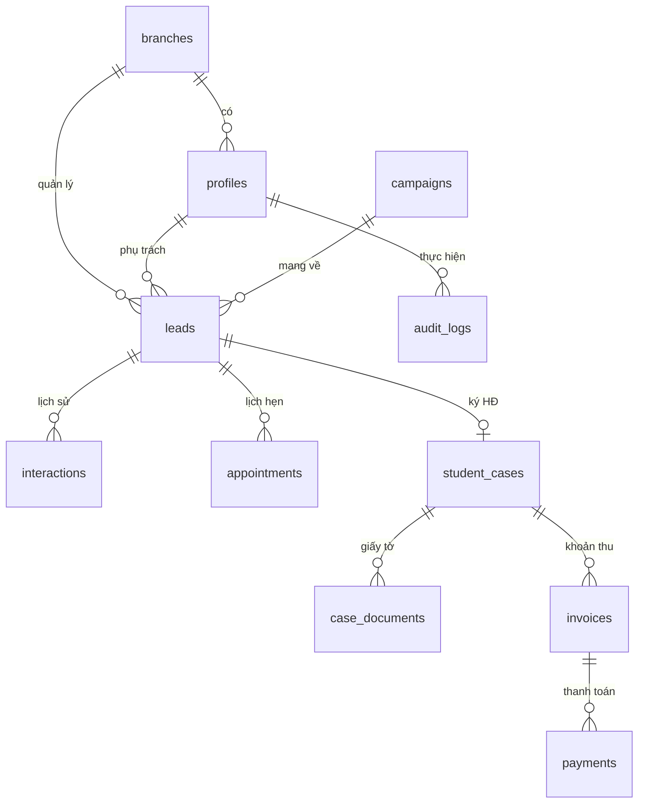
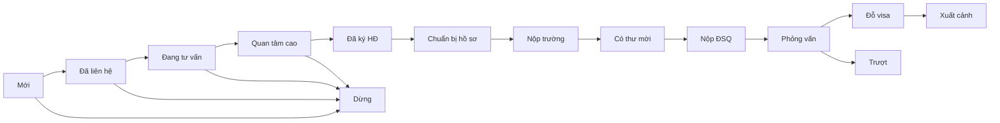

# Bước 2 – Kiến trúc hệ thống & cơ sở dữ liệu

## 1. Tổng quan



| Lớp | Công nghệ | Vai trò |
|---|---|---|
| Giao diện | Next.js (App Router), TypeScript, Tailwind CSS, Recharts | Responsive, tiếng Việt |
| Máy chủ ứng dụng | Server Actions / Route Handlers trên Vercel | Kiểm tra quyền, gọi DB, không lộ khóa bí mật |
| Dữ liệu | Supabase PostgreSQL | Bảng nghiệp vụ, RLS, trigger, view báo cáo |
| Xác thực | Supabase Auth | Đăng nhập email/mật khẩu, MFA (TOTP) |
| Tệp | Supabase Storage (bucket private) | Scan hộ chiếu, học bạ… chỉ truy cập qua signed URL ngắn hạn |
| Tác vụ nền | Supabase Edge Functions + pg_cron | Phân bổ, nhắc lịch, webhook nhận lead |
| Mã nguồn | GitHub (nhánh + Pull Request) | Review trước khi lên production |

## 2. Cấu trúc thư mục

```
crm/
├─ src/
│  ├─ app/                 # Mỗi phân hệ một route: /khach-hang, /ho-so, /visa, /tai-chinh…
│  ├─ components/          # AppShell, ui.tsx (Card, Modal, Drawer…), biểu đồ
│  └─ lib/
│     ├─ types.ts          # Kiểu dữ liệu – khớp 1-1 với bảng SQL
│     ├─ permissions.ts    # Ma trận quyền + phạm vi dữ liệu
│     ├─ assignment.ts     # Thuật toán phân bổ (hàm thuần)
│     ├─ store.tsx         # Lớp dữ liệu: demo = localStorage; sau = Supabase
│     └─ mock-data.ts      # Dữ liệu giả lập
├─ supabase/
│  ├─ migrations/0001_init.sql   # Lược đồ
│  ├─ migrations/0002_rls.sql    # Phân quyền RLS + trigger nhật ký
│  └─ seed.sql
└─ docs/
```

## 3. Lớp dữ liệu có thể thay thế

Giao diện chỉ gọi các *action* trong `src/lib/store.tsx` (`addLead`, `updateLead`, `addPayment`, `applyAssignment`…). Ở giai đoạn 2, phần thân các action được thay bằng **Server Actions** gọi Supabase, giữ nguyên chữ ký hàm → không phải viết lại giao diện. Đọc dữ liệu chuyển sang Server Components + phân trang phía máy chủ.

## 4. Phân quyền

- **Hai lớp:** giao diện ẩn/hiện theo `permissions.ts` (cho dễ dùng); **RLS trong Postgres** là lớp bảo vệ thật – kể cả gọi API trực tiếp cũng không đọc được dữ liệu ngoài phạm vi.
- Phạm vi: Giám đốc – toàn bộ; Quản lý – chi nhánh; Tư vấn – khách mình phụ trách; Kế toán – tài chính; Xử lý hồ sơ – hồ sơ được giao.
- Hàm `app_role()`, `app_branch()` (security definer) đọc từ bảng `profiles`.

## 5. Bảo mật

- Khóa bí mật chỉ nằm trong **Vercel Environment Variables** / `.env.local` (đã gitignore). Không commit API key.
- `SUPABASE_SERVICE_ROLE_KEY` **chỉ dùng phía server**, không bao giờ có tiền tố `NEXT_PUBLIC_`.
- Bắt buộc **MFA** cho Giám đốc và Kế toán; mật khẩu mạnh; khóa tài khoản nhân viên nghỉ việc ngay (cờ `active`).
- Dữ liệu nhạy cảm (số CCCD, hộ chiếu): mã hóa cột bằng `pgcrypto` hoặc Supabase Vault; chỉ hiện 4 số cuối trên giao diện.
- File hồ sơ: bucket private, signed URL hết hạn sau vài phút, ghi nhật ký mỗi lần tải.
- Xuất Excel: chỉ vai trò được phép, ghi nhật ký số dòng xuất.
- Header bảo mật (X-Frame-Options, nosniff…) đã cấu hình trong `next.config.ts`; bật CSP ở giai đoạn 7.
- Tuân thủ quy định bảo vệ dữ liệu cá nhân hiện hành (Nghị định 13/2023/NĐ-CP, Luật Bảo vệ dữ liệu cá nhân – cần xác minh với luật sư).

## 6. Sao lưu & phục hồi

1. **Supabase:** sao lưu hằng ngày / Point-in-Time Recovery tùy gói dịch vụ – *cần kiểm tra gói đang dùng và chính sách hiện tại của Supabase*.
2. **Sao lưu độc lập:** GitHub Action chạy `pg_dump` hằng tuần, mã hóa (age/GPG), đẩy lên kho lưu trữ riêng (không nằm trong repo).
3. **Diễn tập phục hồi** mỗi quý: khôi phục bản sao lưu vào project Supabase thử nghiệm, kiểm tra số liệu.
4. Nhật ký `audit_logs` chỉ được thêm, không sửa/xóa – dùng để truy vết và khôi phục từng bản ghi.

## 7. Giám sát

Vercel Analytics + log, Supabase logs & cảnh báo dung lượng, Sentry (lỗi phía client/server), báo cáo đăng nhập bất thường.

## 8. Sẵn sàng tích hợp AI

- `pgvector` lưu embedding lịch sử tư vấn → tìm khách tương tự, gợi ý kịch bản tư vấn.
- Chấm điểm lead (khả năng chốt) dựa trên nguồn, chương trình, tương tác.
- Tóm tắt cuộc gọi / chuỗi tin nhắn Zalo thành ghi chú.
- OCR giấy tờ (hộ chiếu, học bạ) tự điền hồ sơ, nhân viên kiểm tra lại.
- Nguyên tắc: AI chỉ gợi ý, không tự cam kết visa/việc làm với khách; dữ liệu cá nhân được ẩn danh trước khi gửi ra dịch vụ ngoài.

## 9. Sơ đồ quan hệ dữ liệu (ERD)



## 10. Luồng chuyển trạng thái chính


